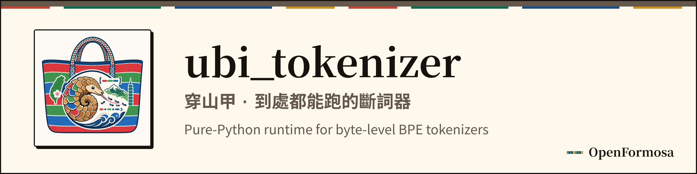

<p align="center"></p>

# ubi_tokenizer

ubi_tokenizer is a pure-Python, dependency-free runtime for byte-level BPE tokenizers. It reads and writes the same `tokenizer.json` as Hugging Face `tokenizers`, so a tokenizer trained elsewhere runs anywhere Python runs.

<p align="center">
  <a href="LICENSE"></a>
  
  <a href="https://discord.gg/N4YnrjjcW7"></a>
</p>

<p align="center"><a href="README.md">繁體中文</a> · <b>English</b></p>

<p align="center">
  <a href="docs/quicktour.md">Quick tour</a> · <a href="docs/">Docs</a> · <a href="https://openformosa.com/community/">Community</a>
</p>

## Why

The core of Hugging Face `tokenizers` is written in Rust. On platforms without prebuilt wheels, in restricted runtimes, or in a classroom, installing it is not always easy. Often we only need to load a `tokenizer.json` and turn text into tokens.

ubi_tokenizer reimplements the same public API with the Python standard library: `Tokenizer`, `Encoding`, `AddedToken`, and the `models`, `pre_tokenizers`, `decoders`, `normalizers`, `processors`, and `trainers` submodules. It needs no Rust, no `torch`, no `transformers`, and no third-party packages. "ubi" stands for ubiquitous.

## Quick start

1. Install:

   ```bash
   pip install ubi-tokenizer
   ```

2. Load a `tokenizer.json` and encode a sentence:

   ```python
   from ubi_tokenizer import Tokenizer

   tok = Tokenizer.from_file("tokenizer.json")
   enc = tok.encode("大家好，歡迎回來。")
   print(enc.ids)
   print(tok.decode(enc.ids))
   ```

3. The second line prints "大家好，歡迎回來。" back.

## Installation

| Item | Requirement |
| --- | --- |
| Python | 3.10 or later |
| Dependencies | None; standard library only |
| Optional | `pip install "ubi-tokenizer[transcription]"`: rich-transcription helpers (also standard library only) |

## Usage

### Encode and decode

`encode` returns an `Encoding` with parallel arrays: `ids`, `tokens`, `type_ids`, `offsets`, `attention_mask`, `special_tokens_mask`, `word_ids`.

```python
enc = tok.encode("大家好，歡迎回來。")
print(enc.tokens)   # byte-mapped subwords
print(enc.offsets)  # character offsets
```

### Batching and padding

```python
tok.enable_padding(pad_id=tok.token_to_id("<|pad|>"), pad_token="<|pad|>")
batch = tok.encode_batch(["abc", "大家好", "123 456"])
texts = tok.decode_batch([e.ids for e in batch])
```

Every encoding is padded to the longest in the batch.

### Special tokens

```python
tok.add_special_tokens(["<|bos|>", "<|eos|>"])
enc = tok.encode("<|bos|>hello<|eos|>")
```

Special tokens are split out longest-match-first and flagged in `enc.special_tokens_mask`. `decode(skip_special_tokens=True)` drops them.

### Training (small corpora)

```python
from ubi_tokenizer import Tokenizer
from ubi_tokenizer.models import BPE
from ubi_tokenizer.pre_tokenizers import ByteLevel as ByteLevelPre
from ubi_tokenizer.decoders import ByteLevel as ByteLevelDec
from ubi_tokenizer.trainers import BpeTrainer

tok = Tokenizer(BPE())
tok.pre_tokenizer = ByteLevelPre()
tok.decoder = ByteLevelDec()

trainer = BpeTrainer(vocab_size=2000, min_frequency=2, special_tokens=["<|unk|>"])
tok.train_from_iterator(corpus_lines, trainer)
tok.save("tokenizer.json")
```

For large or distributed training, use UbiTok. The built-in `BpeTrainer` is for small corpora and tests.

### Compared with Hugging Face `tokenizers`

| | Hugging Face `tokenizers` | `ubi_tokenizer` |
| --- | --- | --- |
| `tokenizer.json` format | yes | **same format** |
| Implementation | Rust core + Python bindings | **pure Python (stdlib only)** |
| Dependencies | Rust toolchain / wheels | **none** |
| Use case | training + inference at scale | **ubiquitous runtime / inference** |

The pipeline is the familiar one: Normalizer → PreTokenizer → Model → PostProcessor → Decoder (see [`docs/components.md`](docs/components.md)).

### Sibling projects

- **UbiTok**: distributed, large-scale tokenizer training. Export there, run here. See [`docs/loading-a-ubitok-export.md`](docs/loading-a-ubitok-export.md).
- **[PangolinBench](https://github.com/OpenFormosa/PangolinBench)**: tokenizer benchmarks.

## Documentation

- [Quick tour](docs/quicktour.md)
- [Components](docs/components.md)
- [Loading a UbiTok export](docs/loading-a-ubitok-export.md)
- [Rich transcription](docs/transcription.md)

## Limitations

- A pure-Python implementation is slower than the Rust one. Use Hugging Face `tokenizers` for high-volume processing.
- The built-in trainer suits small corpora only.

## Contributing

OpenFormosa is a community project. Everyone can be a contributor.

- Questions and discussion: [Discord](https://discord.gg/N4YnrjjcW7) or the [community page](https://openformosa.com/community/)
- Bugs and ideas: [Issues](https://github.com/OpenFormosa/ubi_tokenizer/issues)
- Pull requests: read [CONTRIBUTING.md](https://github.com/OpenFormosa/openformosa.com/blob/main/CONTRIBUTING.md) first
- General contact: <hello@openformosa.com>
- Security: <security@openformosa.com> (please do not open a public issue)
- Code of conduct: [CODE_OF_CONDUCT.md](https://github.com/OpenFormosa/openformosa.com/blob/main/CODE_OF_CONDUCT.md); report to <conduct@openformosa.com>

## License

Code and documentation in this repository are released under the [Apache License 2.0](LICENSE), © 2026 OpenFormosa contributors.

## Acknowledgements

Compute and research support come from Taipei-1, NTU Speech Lab, and NTU SPML Lab. Thanks to everyone who opened an issue, sent a pull request, or joined the discussion.
