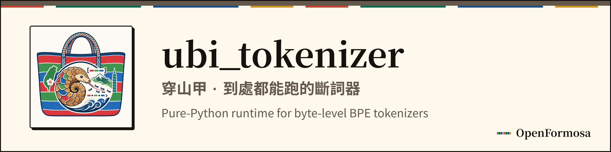

<p align="center"></p>

# ubi_tokenizer

ubi_tokenizer 是純 Python、零相依套件的 byte-level BPE 斷詞器執行環境。它讀寫和 Hugging Face `tokenizers` 相同的 `tokenizer.json`，所以在別處訓練好的斷詞器，可以在任何能跑 Python 的地方使用。

<p align="center">
  <a href="LICENSE"></a>
  
  <a href="https://discord.gg/N4YnrjjcW7"></a>
</p>

<p align="center"><b>繁體中文</b> · <a href="README.en.md">English</a></p>

<p align="center">
  <a href="docs/quicktour.md">快速導覽</a> · <a href="docs/">文件</a> · <a href="https://openformosa.com/community/">社群</a>
</p>

## 為什麼做這個

Hugging Face `tokenizers` 的核心是 Rust。在沒有預先編譯 wheel 的平台、受限的執行環境或教學場合，安裝它不一定容易。很多時候我們只需要「載入 `tokenizer.json`，把文字轉成 token」。

ubi_tokenizer 用 Python 標準函式庫重寫同一套公開 API：`Tokenizer`、`Encoding`、`AddedToken`，以及 `models`、`pre_tokenizers`、`decoders`、`normalizers`、`processors`、`trainers` 子模組。它不需要 Rust、`torch`、`transformers` 或任何第三方套件。名稱中的 ubi 取自 ubiquitous，意思是到處都能跑。

## 快速開始

1. 安裝：

   ```bash
   pip install ubi-tokenizer
   ```

2. 載入 `tokenizer.json` 並編碼一句話：

   ```python
   from ubi_tokenizer import Tokenizer

   tok = Tokenizer.from_file("tokenizer.json")
   enc = tok.encode("大家好，歡迎回來。")
   print(enc.ids)
   print(tok.decode(enc.ids))
   ```

3. 第二行會印回「大家好，歡迎回來。」。

## 安裝

| 項目 | 需求 |
| --- | --- |
| Python | 3.10 以上 |
| 相依套件 | 無，只用 Python 標準函式庫 |
| 選用 | `pip install "ubi-tokenizer[transcription]"`：rich transcription 輔助工具（同樣只用標準函式庫） |

## 使用範例

### 編碼與解碼

`encode` 回傳 `Encoding`，包含平行陣列：`ids`、`tokens`、`type_ids`、`offsets`、`attention_mask`、`special_tokens_mask`、`word_ids`。

```python
enc = tok.encode("大家好，歡迎回來。")
print(enc.tokens)   # byte-mapped subwords
print(enc.offsets)  # character offsets
```

### 批次與補齊

```python
tok.enable_padding(pad_id=tok.token_to_id("<|pad|>"), pad_token="<|pad|>")
batch = tok.encode_batch(["abc", "大家好", "123 456"])
texts = tok.decode_batch([e.ids for e in batch])
```

每筆編碼都會補齊到批次中最長的長度。

### 特殊 token

```python
tok.add_special_tokens(["<|bos|>", "<|eos|>"])
enc = tok.encode("<|bos|>hello<|eos|>")
```

特殊 token 會以最長匹配優先切出，並標在 `enc.special_tokens_mask`。`decode(skip_special_tokens=True)` 會略過它們。

### 訓練（小型語料）

```python
from ubi_tokenizer import Tokenizer
from ubi_tokenizer.models import BPE
from ubi_tokenizer.pre_tokenizers import ByteLevel as ByteLevelPre
from ubi_tokenizer.decoders import ByteLevel as ByteLevelDec
from ubi_tokenizer.trainers import BpeTrainer

tok = Tokenizer(BPE())
tok.pre_tokenizer = ByteLevelPre()
tok.decoder = ByteLevelDec()

trainer = BpeTrainer(vocab_size=2000, min_frequency=2, special_tokens=["<|unk|>"])
tok.train_from_iterator(corpus_lines, trainer)
tok.save("tokenizer.json")
```

大型或分散式訓練請用 UbiTok。內建的 `BpeTrainer` 適合小型語料與測試。

### 和 Hugging Face `tokenizers` 的比較

| | Hugging Face `tokenizers` | `ubi_tokenizer` |
| --- | --- | --- |
| `tokenizer.json` 格式 | 是 | **相同格式** |
| 實作 | Rust 核心加 Python 綁定 | **純 Python（只用標準函式庫）** |
| 相依套件 | Rust 工具鏈或 wheel | **無** |
| 用途 | 大規模訓練與推論 | **到處都能跑的執行與推論** |

處理流程與 Hugging Face 相同：Normalizer → PreTokenizer → Model → PostProcessor → Decoder（見 [`docs/components.md`](docs/components.md)）。

### 相關專案

- **UbiTok**：分散式、大規模的斷詞器訓練。在那裡匯出，在這裡執行。見 [`docs/loading-a-ubitok-export.md`](docs/loading-a-ubitok-export.md)。
- **[PangolinBench](https://github.com/OpenFormosa/PangolinBench)**：斷詞器評測。

## 文件

- [快速導覽](docs/quicktour.md)
- [元件](docs/components.md)
- [載入 UbiTok 匯出的斷詞器](docs/loading-a-ubitok-export.md)
- [Rich transcription](docs/transcription.md)

## 限制

- 純 Python 實作比 Rust 版慢。大量資料的處理請用 Hugging Face `tokenizers`。
- 內建訓練器只適合小型語料。

## 參與貢獻

OpenFormosa 是社群專案，每個人都可以是貢獻者。

- 討論與提問：[Discord](https://discord.gg/N4YnrjjcW7) 或 [社群頁](https://openformosa.com/community/)
- 回報問題或提議功能：[Issues](https://github.com/OpenFormosa/ubi_tokenizer/issues)
- 送出修改：請先讀 [CONTRIBUTING.md](https://github.com/OpenFormosa/openformosa.com/blob/main/CONTRIBUTING.md)
- 一般聯絡：<hello@openformosa.com>
- 安全問題：<security@openformosa.com>（請不要公開發 issue）
- 行為準則：[CODE_OF_CONDUCT.md](https://github.com/OpenFormosa/openformosa.com/blob/main/CODE_OF_CONDUCT.md)，回報請寄 <conduct@openformosa.com>

## 授權

本 repository 的程式碼與文件以 [Apache License 2.0](LICENSE) 釋出，© 2026 OpenFormosa contributors。

## 致謝

本專案的運算資源與研究支持來自 Taipei-1、臺大語音實驗室（NTU Speech Lab）與 NTU SPML Lab。感謝每一位提出問題、送出 PR 與參與討論的貢獻者。
